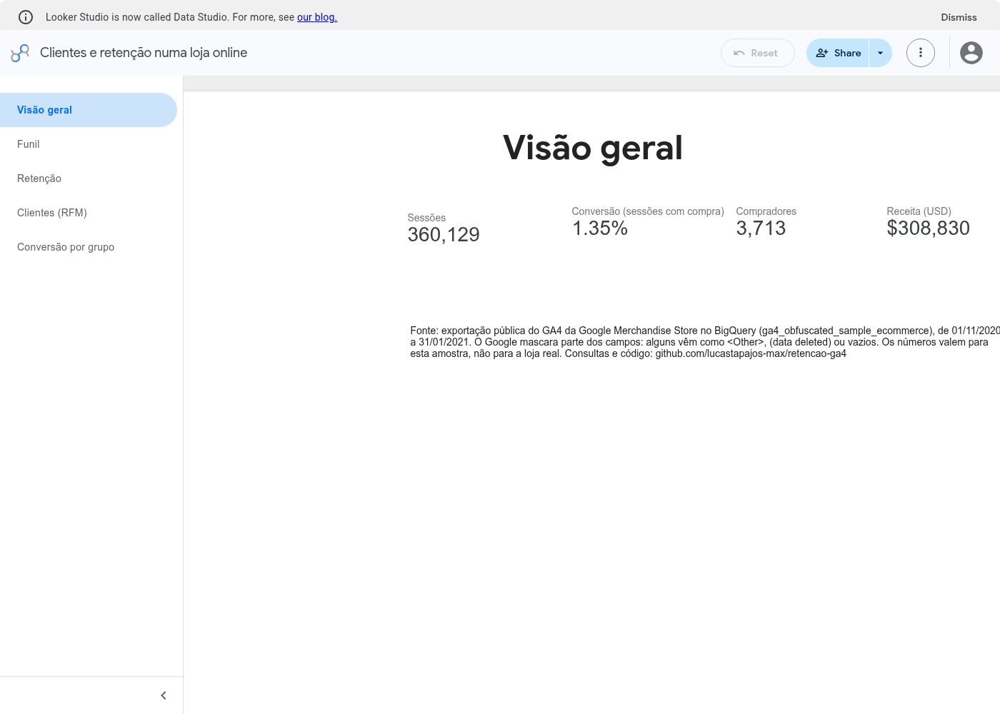
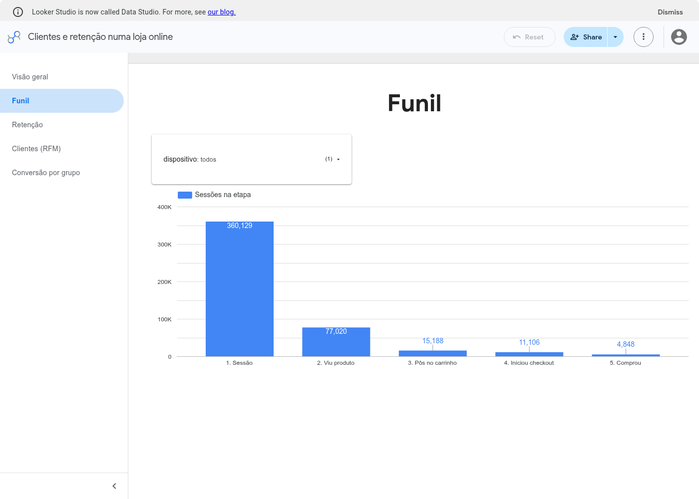
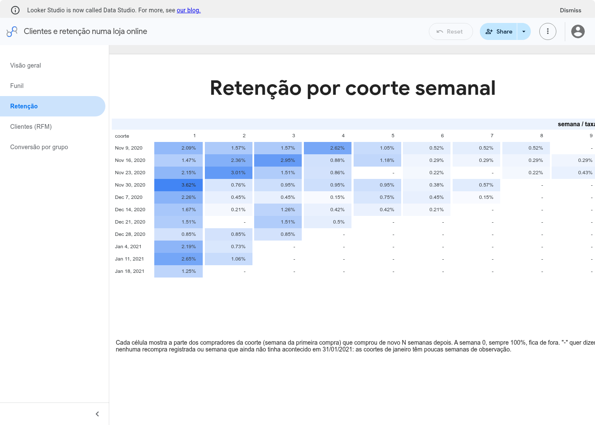
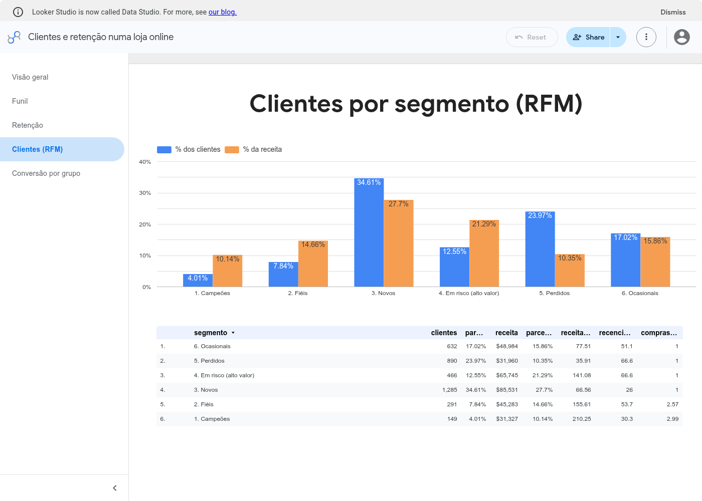
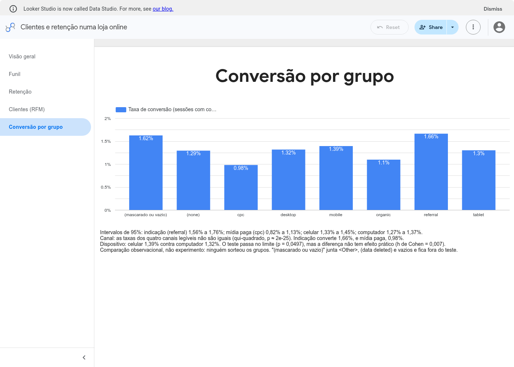

# Clientes e retenção numa loja online

Análise em SQL (BigQuery) e Python sobre a exportação pública do GA4 da Google Merchandise Store, com painel no Data Studio.

**[Abrir o painel](https://datastudio.google.com/reporting/c90a7ec2-8e4d-4aaf-8732-3090e4bda3d7)** (link público, sem login)



## Pergunta

Quais clientes valem a pena reter, e onde a loja perde os outros?

São quatro perguntas menores, uma por análise:

| # | Pergunta | Análise | Consulta |
|---|---|---|---|
| P1 | Em que etapa do caminho até a compra mais gente desiste? | Funil | [`sql/02_funil.sql`](sql/02_funil.sql) |
| P2 | Quem compra volta a comprar? Quanto tempo depois? | Coortes semanais | [`sql/03_coortes.sql`](sql/03_coortes.sql) |
| P3 | Quem são os clientes mais valiosos, e quantos estão sumindo? | Segmentação RFM | [`sql/04_rfm.sql`](sql/04_rfm.sql) |
| P4 | A conversão muda de verdade entre canais ou dispositivos, ou é acaso? | Teste de proporções | [`sql/05_conversao_por_grupo.sql`](sql/05_conversao_por_grupo.sql) e [`analise/teste_proporcoes.py`](analise/teste_proporcoes.py) |

## Dados

- **Tabela:** `bigquery-public-data.ga4_obfuscated_sample_ecommerce.events_*`, eventos do GA4 da Google Merchandise Store de 01/11/2020 a 31/01/2021.
- **Tamanho:** 4.295.584 eventos, 270.154 usuários, 360.129 sessões e 3.713 compradores ([`resultados/00_perfil.csv`](resultados/00_perfil.csv)).
- **Limite declarado pelo Google:** a amostra é mascarada. Alguns campos vêm como `<Other>`, `(data deleted)` ou vazios, e a consistência interna é limitada. No canal de origem, 20,7% das sessões (74.687 de 360.129) caem nesse grupo ([`resultados/05_conversao_por_grupo.csv`](resultados/05_conversao_por_grupo.csv)). Os números valem para esta amostra, não para a loja real.

## Método

- **Funil:** a unidade é a sessão. Uma sessão conta numa etapa se teve pelo menos um evento dela (`session_start`, `view_item`, `add_to_cart`, `begin_checkout`, `purchase`). O GA4 não garante a ordem dos eventos, então as etapas não são exigidas em sequência.
- **Coortes:** cada comprador entra na coorte da semana da primeira compra. A retenção é a parte da coorte que comprou de novo 1, 2, 3… semanas depois.
- **RFM:** só compradores. Recência e valor em quintis; frequência em três faixas (1, 2, 3 ou mais compras), porque 88,1% dos compradores (3.273 de 3.713) compraram uma vez só e quintis de frequência não separariam ninguém ([`resultados/00_perfil.csv`](resultados/00_perfil.csv)). Os segmentos saem de uma tabela de regras no próprio SQL. O empate nos quintis é desfeito pelo id do usuário, para o resultado ser o mesmo a cada execução.
- **Teste:** z de duas proporções para celular contra computador, com intervalo de 95% e h de Cohen; qui-quadrado para os quatro canais legíveis juntos. É uma comparação observacional: ninguém sorteou os grupos, então uma diferença aqui não prova causa. O cálculo tem um teste automatizado contra um caso feito à mão ([`tests/test_teste_proporcoes.py`](tests/test_teste_proporcoes.py)).
- **Painel:** cada fonte do Data Studio é uma consulta personalizada sobre a tabela pública, com o mesmo SQL deste repositório. Nada fica salvo no projeto do BigQuery, porque no sandbox gratuito tabelas e views expiram em 60 dias.

## Resultados

### P1. A maior perda está logo na entrada

| Etapa | Sessões | Passam da etapa anterior |
|---|---:|---:|
| Sessão | 360.129 | |
| Viu produto | 77.020 | 21,4% |
| Pôs no carrinho | 15.188 | 19,7% |
| Iniciou checkout | 11.106 | 73,1% |
| Comprou | 4.848 | 43,7% |

Quase quatro em cada cinco sessões não chegam a ver um produto. Depois do carrinho a perda cai: 73,1% seguem para o checkout. A conversão total é de 1,35% das sessões. Fonte: [`resultados/02_funil.csv`](resultados/02_funil.csv).



### P2. Quase ninguém volta a comprar

Só 440 dos 3.713 compradores compraram mais de uma vez em três meses ([`resultados/00_perfil.csv`](resultados/00_perfil.csv)). Nas coortes semanais, a recompra fica entre 0% e 3,6% por semana; o ponto mais alto é a coorte de 30/11/2020 na semana seguinte à primeira compra, com 3,62% ([`resultados/03_coortes.csv`](resultados/03_coortes.csv)). As coortes de janeiro têm poucas semanas de observação. No painel, "-" quer dizer nenhuma recompra registrada ou semana que ainda não tinha acontecido em 31/01/2021.



### P3. Um grupo pequeno, que sumiu, carrega um quinto da receita

| Segmento | Clientes | % dos clientes | % da receita | Receita média (US$) |
|---|---:|---:|---:|---:|
| Campeões | 149 | 4,01% | 10,14% | 210,25 |
| Fiéis | 291 | 7,84% | 14,66% | 155,61 |
| Novos | 1.285 | 34,61% | 27,70% | 66,56 |
| Em risco (alto valor) | 466 | 12,55% | 21,29% | 141,08 |
| Perdidos | 890 | 23,97% | 10,35% | 35,91 |
| Ocasionais | 632 | 17,02% | 15,86% | 77,51 |

O grupo "Em risco" junta quem gastou muito, comprou uma vez e não volta há 66,6 dias em média. São 12,55% dos clientes e 21,29% da receita. Gastaram em média US$ 141,08 cada, quase quatro vezes o grupo Perdidos (US$ 35,91). Fonte: [`resultados/04_rfm.csv`](resultados/04_rfm.csv).



### P4. O canal pesa; o dispositivo, não

- **Canal:** as taxas dos quatro canais legíveis não são iguais (qui-quadrado = 118,0, 3 graus de liberdade, p ≈ 2e-25). Indicação (`referral`) converte 1,66% das sessões (intervalo de 95%: 1,56% a 1,76%); mídia paga (`cpc`), 0,98% (0,82% a 1,13%).
- **Dispositivo:** celular converte 1,39% e computador, 1,32%. A diferença passa no limite (p = 0,0497), mas o intervalo da diferença vai de 0,00 a 0,16 ponto percentual e o h de Cohen é 0,007: não tem efeito prático.

Fontes: [`resultados/05_conversao_por_grupo.csv`](resultados/05_conversao_por_grupo.csv) e [`resultados/06_testes.csv`](resultados/06_testes.csv).



## O que os dados não permitem concluir

- Três meses de dados mascarados não dizem qual é a retenção da loja de verdade, nem como ela muda ao longo do ano.
- O canal é o do primeiro acesso do usuário. Uma pessoa que chegou por indicação e depois voltou por anúncio conta como indicação.
- Os testes comparam grupos que se escolheram sozinhos. Indicação convertendo mais não quer dizer que mais indicação traria mais vendas.

## Como reproduzir

1. Rode os arquivos de [`sql/`](sql/) no BigQuery (o sandbox gratuito basta: a consulta de perfil leu 1,01 GB, e a cota gratuita é de 1 TB por mês) e salve as saídas em `resultados/`.
2. Instale as dependências e rode o teste estatístico:

```bash
pip install -r requirements.txt
python analise/teste_proporcoes.py
pytest
```

## Estrutura

```
sql/          consultas do BigQuery (00 a 05)
analise/      teste de proporções em Python
resultados/   saídas das consultas e dos testes, em CSV
tests/        teste automatizado do cálculo estatístico
docs/         especificação e prints do painel
```
